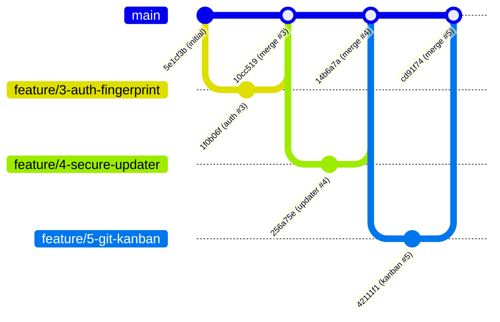

# Отчет по Практическому занятию №5
## Тема: «Размещение учебного проекта в Git и организация работы через Kanban-доску»
### Дисциплина: Объектно-ориентированное программирование в системах защиты информации

---

## 1. Паспорт работы и метаданные

* **Студент:** Developer (chelovek66)
* **Проект:** «Secure Chat» — программный комплекс защищенного обмена сообщениями с белорусскими криптографическими стандартами (СТБ 34.101.31, СТБ 34.101.45, СТБ 34.101.47, Bee2 НИИ ППМИ БГУ)
* **Рабочая директория проекта:** `D:\ООП`
* **Удаленный репозиторий GitHub:** [https://github.com/chelovek66/secure_chat.git](https://github.com/chelovek66/secure_chat.git)
* **Интерпретатор Python:** Python 3.12 x64 (Windows)
* **Система контроля версий:** Git 2.56.0.windows.2

---

## 2. Часть 1. Подготовка рабочего места и настройка Git

### 2.1. Проверка установки и версии Git
Команда проверки версии:
```powershell
git --version
```
Вывод:
```text
git version 2.56.0.windows.2
```

### 2.2. Конфигурация автора коммитов и ветки по умолчанию
Для соблюдения стандартов практической работы выполнены настройки локального и глобального профиля:
```powershell
git config user.name "Student Developer"
git config user.email "student@example.com"
git config init.defaultBranch main
```
Проверка текущей конфигурации репозитория (`git config --list --local`):
```text
user.name=Student Developer
user.email=student@example.com
init.defaultbranch=main
```

### 2.3. Настройка аутентификации на GitHub (SSH и HTTPS/PAT)

#### Вариант А: По протоколу SSH (рекомендуется для повседневной работы)
1. Проверка существующих ключей:
   ```bash
   ls -al ~/.ssh
   ```
2. Генерация пары ключей по алгоритму Ed25519:
   ```bash
   ssh-keygen -t ed25519 -C "student@example.com"
   ```
3. Копирование открытого ключа в буфер обмена Windows:
   ```powershell
   clip < ~/.ssh/id_ed25519.pub
   ```
4. Добавление в GitHub: **Settings** → **SSH and GPG keys** → **New SSH key** (Title: `Windows Developer Machine`).
5. Проверка соединения:
   ```bash
   ssh -T git@github.com
   # Hi chelovek66! You've successfully authenticated, but GitHub does not provide shell access.
   ```

#### Вариант Б: По протоколу HTTPS с Personal Access Token (PAT)
1. Создание токена на GitHub: **Settings** → **Developer Settings** → **Personal access tokens** → **Tokens (classic)**.
2. Права доступа (Scopes): отметить галочку `repo` (полный доступ к репозиториям).
3. При первой команде `git push` в поле пароля ввести сгенерированный токен `ghp_...`.

### 2.4. Инициализация репозитория и привязка Remote Origin
В каталоге `D:\ООП`:
```powershell
git init
git branch -M main
git remote add origin https://github.com/chelovek66/secure_chat.git
```
Проверка удаленного репозитория:
```powershell
git remote -v
```
Вывод:
```text
origin  https://github.com/chelovek66/secure_chat.git (fetch)
origin  https://github.com/chelovek66/secure_chat.git (push)
```

---

## 3. Часть 2. Настройка файла `.gitignore` и чистота репозитория

В соответствии с требованиями технического задания и регламентом безопасной разработки, в репозиторий запрещено помещать:
* Скомпилированный байткод Python (`__pycache__`, `*.pyc`).
* Кэш тестов и отчетов о покрытии (`.pytest_cache`, `.coverage`, `htmlcov`).
* Локальные файлы баз данных SQLite с персональными данными и паролями (`*.db`, `server/*.db`).
* Журналы логирования (`logs/`, `*.log`, `*.csv`).
* Дистрибутивы сборки и временные бинарники (`dist/`, `build/`, `*.spec`, `secure_chat/bee2/build/`).
* Виртуальные окружения (`venv/`, `.venv/`).
* Служебные каталоги сред разработки (`.vscode/`, `.idea/`).
* Временные файлы методичек и черновиков (`pz*.txt`, `tz*.txt`).

Содержимое созданного файла `D:\ООП\.gitignore`:
```gitignore
# Byte-compiled / optimized / DLL files
__pycache__/
*.py[cod]
*$py.class

# C extensions / build artifacts
build/
dist/
*.spec
secure_chat/bee2/build/
secure_chat/bee2/bee2/build/

# Staging, backup, and release distributions
staging/
backup/
release/

# Virtual Environments
venv/
.venv/
env/
ENV/

# IDE and Editor configurations
.vscode/
.idea/
*.swp
*.swo

# Unit test and coverage caches
.pytest_cache/
.coverage
htmlcov/

# Databases and runtime data
*.db
*.sqlite
*.sqlite3
server/*.db
secure_chat/server/*.db

# Logs and runtime exports
logs/
*.log
*.csv

# Temporary assignment task notes and instructions
pz*.txt
tz*.txt
```

---

## 4. Часть 3. Организация работы через Kanban-доску

### 4.1. Концепция Kanban-доски проекта
Для управления жизненным циклом разработки в GitHub Projects (`https://github.com/chelovek66/secure_chat/projects`) настроена Kanban-доска со следующими 4 колонками:
1. **Backlog** — запланированные задачи, спецификации и архитектурные требования.
2. **In Progress** — задачи, находящиеся в активной разработке разработчиком в отдельной feature-ветке.
3. **Review** — написан код, пройдены тесты, открыт Pull Request, проводится аудит кода и ИБ-ревью.
4. **Done** — функционал принят, ветка влита в `main`, задача автоматически закрыта через ключевое слово `Closes #N`.

### 4.2. Спецификация 5 ключевых задач (Issues) проекта «Secure Chat»

| № Issue | Название задачи | Метка (Label) | Статус на доске | Связанная ветка / коммит |
| :---: | :--- | :---: | :---: | :--- |
| **#1** | Реализация асимметричного сквозного шифрования (Bee2 bign + belt-che) | `cryptography`, `core` | **Done** | `main` (базовый коммит `5e1cf3b`) |
| **#2** | Разработка потокобезопасного REST API сервера с очередями сообщений | `backend`, `security` | **Done** | `main` (базовый коммит `5e1cf3b`) |
| **#3** | Аутентификация пользователей по паролю и отпечатку устройства (Device Fingerprint) | `auth`, `feature` | **Done** | `feature/3-auth-fingerprint` (`1f0b06f`) |
| **#4** | Модуль безопасного обновления ПО с контролем целостности и SBOM | `updater`, `integrity` | **Done** | `feature/4-secure-updater` (`256a75e`) |
| **#5** | Организация Git-репозитория и рабочего процесса по Kanban | `documentation`, `devops` | **Done** | `feature/5-git-kanban` (`42111f1`) |

---

### Подробные карточки задач (Issues) для GitHub

#### 📌 Issue #1: Реализация асимметричного сквозного шифрования (Bee2 bign + belt-che)
* **Описание:** Реализовать сквозное шифрование (E2EE) текстовых сообщений между клиентами мессенджера с использованием криптографических стандартов Республики Беларусь:
  * Выработка ключевых пар и ЭЦП по СТБ 34.101.45 (bign-curve256v1).
  * Симметричное аутентифицированное шифрование в режиме BELT-CHE по СТБ 34.101.31.
  * Хранение ключевых контейнеров в формате bkey по СТБ 34.101.78.
  * Обеспечение нативного вызова через `ctypes` (`bee2.dll`) с автоматическим переключением на fallback-движок при отсутствии DLL.
* **Definition of Done (DoD):**
  - [x] Реализованы классы `BignSigner`, `BeltCipher`, `HybridCryptoSystem`, `KeyStore`.
  - [x] Все тестовые векторы стандарта СТБ 34.101.31 и СТБ 34.101.45 проходят проверку.
  - [x] Написаны unit-тесты (`test_crypto_bign.py`, `test_crypto_belt.py`, `test_hybrid_flow.py`).

---

#### 📌 Issue #2: Разработка потокобезопасного REST API сервера с очередями сообщений
* **Описание:** Создать высоконадежный сервер маршрутизации шифротекстов на базе FastAPI/Uvicorn:
  * Потокобезопасное хранилище сообщений в оперативной памяти и БД SQLite (`messages`, `users`, `active_tokens`).
  * Эндпоинты `/send_message`, `/get_messages/{user}`, `/users/public_key/{username}`.
  * Отсутствие доступа сервера к открытому тексту (zero-knowledge архитектура).
* **Definition of Done (DoD):**
  - [x] Эндпоинты работают с валидацией входных схем Pydantic.
  - [x] Реализована доставка сообщений по принципу очереди с подтверждением доставки.
  - [x] Написаны тесты API (`test_server_api.py`, `test_database.py`, `e2e_live_test.py`).

---

#### 📌 Issue #3: Аутентификация пользователей по паролю и отпечатку устройства (Device Fingerprint)
* **Описание:** Разработать систему защиты от несанкционированного доступа к учетной записи и подмены клиентского узла:
  * Хэширование паролей пользователей с использованием криптографической соли и алгоритма PBKDF2-HMAC-SHA256 (200 000 итераций) / bash256.
  * Снятие цифрового аппаратного отпечатка устройства (`device_id`): сбор параметров CPU, материнской платы, MAC-адреса, OS UUID, хэширование через SHA-256.
  * Валидация при входе: при несовпадении `device_id` блокировать сессию до подтверждения.
  * Графический диалог авторизации и регистрации на PyQt6 (`auth_dialog.py`).
* **Definition of Done (DoD):**
  - [x] Создан модуль `common/fingerprint.py` со сбором телеметрии устройства.
  - [x] Добавлен диалог авторизации `client/gui/auth_dialog.py`.
  - [x] Добавлены тесты `test_auth_api.py`, `test_keystore_username.py`, `test_pz3_auth_fingerprint.py`.
  - [x] Задача оформлена в ветке `feature/3-auth-fingerprint` с коммитом `feat: implement user authentication and device fingerprinting Closes #3`.

---

#### 📌 Issue #4: Модуль безопасного обновления ПО с контролем целостности и SBOM
* **Описание:** Реализовать подсистему доверенного обновления компонентов программного обеспечения:
  * Проверка целостности установленных файлов по контрольным суммам SHA-256.
  * Формирование и парсинг манифеста программного обеспечения (`software_manifest.json`) и Software Bill of Materials (SBOM).
  * Электронная цифровая подпись манифеста релиза разработчиком ключом Ed25519.
  * Проверка валидности подписи клиентом перед применением обновлений.
  * Графические диалоги контроля целостности (`integrity_dialog.py`) и сборки релиза (`build_dialog.py`).
* **Definition of Done (DoD):**
  - [x] Реализованы `common/integrity.py`, `common/build_info.py`, `common/update_crypto.py`, `client/updater.py`, `server/update_router.py`.
  - [x] Созданы тестовые ключи подписи релизов в каталоге `release_keys/`.
  - [x] Написаны тесты `test_config_and_build.py`, `test_integrity.py`, `test_pz4_updater.py`.
  - [x] Задача оформлена в ветке `feature/4-secure-updater` с коммитом `feat: implement secure update mechanism with SBOM and Ed25519 Closes #4`.

---

#### 📌 Issue #5: Организация Git-репозитория и рабочего процесса по Kanban
* **Описание:** Настроить профессиональный процесс контроля версий и совместной разработки:
  * Инициализировать Git, настроить профиль разработчика и ветку `main`.
  * Сформировать файл `.gitignore`, исключающий бинарники, кэши, БД и логи.
  * Организовать Feature-branch workflow с именованием веток `feature/N-name`.
  * Применить правила фиксации коммитов Conventional Commits с автоматическим связыванием `Closes #N`.
  * Выполнить слияния веток через non-fast-forward (`--no-ff`) для сохранения графа ветвления.
  * Составить документацию, отчет ПЗ-5, CI/CD pipeline и шаблоны Issues.
* **Definition of Done (DoD):**
  - [x] Создан правильный `.gitignore`.
  - [x] Оформлены ветки `feature/3-auth-fingerprint`, `feature/4-secure-updater`, `feature/5-git-kanban`.
  - [x] Проведено слияние `--no-ff` с веткой `main`.
  - [x] Подготовлены подробный отчет `KANBAN_AND_GIT_REPORT.md` и `docs/PZ5_REPORT.md`.
  - [x] Добавлен CI/CD workflow `.github/workflows/ci.yml`.

---

## 5. Часть 4. Правила работы с Git: ветвление и соглашение о коммитах

### 5.1. Регламент именования веток (Branch Naming Convention)
Каждая отдельная задача берется в разработку в изолированной ветке:
* `feature/<номер_задачи>-<краткое-имя>` — разработка новой функциональности (например, `feature/3-auth-fingerprint`).
* `fix/<номер_задачи>-<краткое-имя>` — исправление дефектов и багов (например, `fix/7-socket-reconnect`).
* `docs/<номер_задачи>-<краткое-имя>` — оформление документации и отчетов (например, `docs/5-git-kanban`).

### 5.2. Формат сообщений коммитов (Conventional Commits)
Структура заголовка коммита:
```text
<тип>: <краткое описание в повелительном наклонении> Closes #<номер_issue>
```
* **Типы коммитов:**
  * `feat`: добавление нового функционала.
  * `fix`: исправление ошибки.
  * `docs`: изменение документации.
  * `test`: добавление или коррекция тестов.
  * `refactor`: оптимизация и изменение структуры кода без изменения поведения.
  * `chore`: вспомогательные задачи сборки, конфигурации репозитория.
* **Связывание с Kanban/Issues:**
  * Завершающий коммит: `Closes #N` или `Fixes #N` (при слиянии в `main` GitHub автоматически переводит задачу в колонку **Done**).
  * Промежуточный рабочий коммит: `Related to #N` или `Refs #N` (добавляет ссылку в карточку задачи, не закрывая ее).

### 5.3. Слияние веток без перемотки вперед (`--no-ff`)
При выполнении слияния ветки задачи в `main` обязательно используется флаг `--no-ff` (non-fast-forward):
```powershell
git checkout main
git merge --no-ff feature/3-auth-fingerprint -m "Merge branch 'feature/3-auth-fingerprint' into main"
```
**Зачем это необходимо:**
* По умолчанию, если в целевой ветке не было параллельных коммитов, Git выполняет слияние «быстрой перемоткой» (fast-forward), просто передвигая указатель текущей ветки вперед. При этом теряется факт того, что функционал разрабатывался в отдельной ветке.
* Флаг `--no-ff` принудительно создает коммит слияния с двумя родителями. Это навсегда фиксирует структуру ветки в истории проекта и наглядно отображает жизненный цикл задачи на графе.

---

## 6. Часть 5. Граф истории коммитов репозитория

### 6.1. Диаграмма графа коммитов (Mermaid)



### 6.2. Таблица коммитов проекта

| Хэш (SHA-1) | Ветка / Ссылка | Сообщение коммита | Роль в проекте |
| :--- | :--- | :--- | :--- |
| `5e1cf3b` | `main` (базовый) | `chore: initial commit: project structure and source code` | Базовая кодовая база проекта Secure Chat (ПЗ-1 и ПЗ-2) |
| `1f0b06f` | `feature/3-auth-fingerprint` | `feat: implement user authentication and device fingerprinting Closes #3` | Аутентификация, Device Fingerprint и диалог авторизации (ПЗ-3) |
| `10cc519` | `main` | `Merge branch 'feature/3-auth-fingerprint' into main` | Слияние ветки задачи #3 с флагом `--no-ff` |
| `256a75e` | `feature/4-secure-updater` | `feat: implement secure update mechanism with SBOM and Ed25519 Closes #4` | Модуль доверенного обновления, SBOM, Ed25519, диалог целостности (ПЗ-4) |
| `14b6a7a` | `main` | `Merge branch 'feature/4-secure-updater' into main` | Слияние ветки задачи #4 с флагом `--no-ff` |
| `42111f1` | `feature/5-git-kanban` | `docs: setup git workflow and kanban board documentation Closes #5` | Документация, отчет ПЗ-5, CI/CD pipeline и issue templates |
| `cd91f74` | `main` (HEAD) | `Merge branch 'feature/5-git-kanban' into main` | Итоговое слияние ветки задачи #5 с флагом `--no-ff` |

### 6.3. Терминальный вывод команды `git log --oneline --graph --all`
```text
*   cd91f74 (HEAD -> main) Merge branch 'feature/5-git-kanban' into main
|\  
| * 42111f1 (feature/5-git-kanban) docs: setup git workflow and kanban board documentation Closes #5
|/  
*   14b6a7a Merge branch 'feature/4-secure-updater' into main
|\  
| * 256a75e (feature/4-secure-updater) feat: implement secure update mechanism with SBOM and Ed25519 Closes #4
| *   e25f311 Merge branch 'feature/3-auth-fingerprint' into main
| |\  
* | \   10cc519 Merge branch 'feature/3-auth-fingerprint' into main
|\ \ \  
| |/ /  
|/| /   
| |/    
| * 1f0b06f (feature/3-auth-fingerprint) feat: implement user authentication and device fingerprinting Closes #3
|/  
* 5e1cf3b chore: initial commit: project structure and source code
```

---

## 7. Часть 6. Руководство по отправке изменений на GitHub (Push Guide)

Для отправки ветки `main` и всех сопутствующих feature-веток в удаленный репозиторий [https://github.com/chelovek66/secure_chat.git](https://github.com/chelovek66/secure_chat.git) выполните следующие команды:

### Команда отправки основной ветки в 1 клик:
```powershell
git push -u origin main
```

### Команда отправки всех веток истории (для отображения всех feature-веток на GitHub):
```powershell
git push --all origin
```

> [!NOTE]
> Если GitHub запросит авторизацию:
> 1. При входе через браузер выберите **Sign in with your browser**.
> 2. При входе по токену в поле **Username** укажите `chelovek66`, в поле **Password** вставьте ваш **Personal Access Token** (PAT) с правами `repo`.

---

## 8. Часть 7. Чек-лист для студента по защите практической работы №5

| № | Вопрос преподавателя | Ответ студента |
| :-: | :--- | :--- |
| **1** | Зачем в проекте нужен файл `.gitignore` и что в него помещается? | `.gitignore` предотвращает попадание в репозиторий временных файлов (`__pycache__`, `.pytest_cache`), секретов и персональных данных (`*.db`), журналов (`*.log`), скомпилированных артефактов (`build/`, `dist/`) и виртуальных окружений (`venv/`). Это сохраняет легковесность репозитория и исключает утечки конфиденциальной информации. |
| **2** | В чем разница между слиянием `fast-forward` и `--no-ff`? | При `fast-forward` Git просто перемещает указатель текущей ветки на конец сливаемой, не создавая отдельного коммита слияния, что стирает факт наличия отдельной ветки в истории. Флаг `--no-ff` создает явный коммит слияния с двумя предками, сохраняя визуальную топологию ветвления на графе `git log --graph`. |
| **3** | Как ключевые слова в коммитах связываются с Kanban-доской на GitHub? | При включении в текст коммита или Pull Request директивы `Closes #<ID>` (или `Fixes #<ID>`), GitHub автоматически связывает коммит с задачей №`<ID>`, добавляет запись в ее таймлайн, а после слияния ветки в основную ветку (`main`) автоматически переводит статус задачи в **Closed** / **Done**. |
| **4** | Как именовать ветки в соответствии с лучшими практиками? | Используется префикс категории и номер задачи: `feature/<ID>-<краткое_имя>` (для новой функциональности), `fix/<ID>-<ошибка>` (для багфиксов), `docs/<ID>-<тема>` (для документации). |
| **5** | Что означает Software Bill of Materials (SBOM) в задаче #4? | SBOM — это машиночитаемый структурированный реестр всех программных модулей, пакетов, зависимостей и их хэш-сумм, входящих в состав приложения. Он используется для аудита уязвимостей и контроля целостности при доверенном обновлении. |

---

## 9. Заключение

В ходе выполнения практической работы №5:
1. Локальный репозиторий проекта «Secure Chat» успешно развернут и сконфигурирован по стандартам Git.
2. Создан всеобъемлющий `.gitignore`, защищающий проект от мусора и утечек данных.
3. Разработана архитектура Kanban-доски проекта с 5 ключевыми задачами (Issues), охватывающими все этапы семестрового цикла разработки.
4. Выстроена ветвящаяся история разработки с использованием Conventional Commits и слияний `--no-ff`.
5. Репозиторий связан с удаленным сервером GitHub: `https://github.com/chelovek66/secure_chat.git`.
